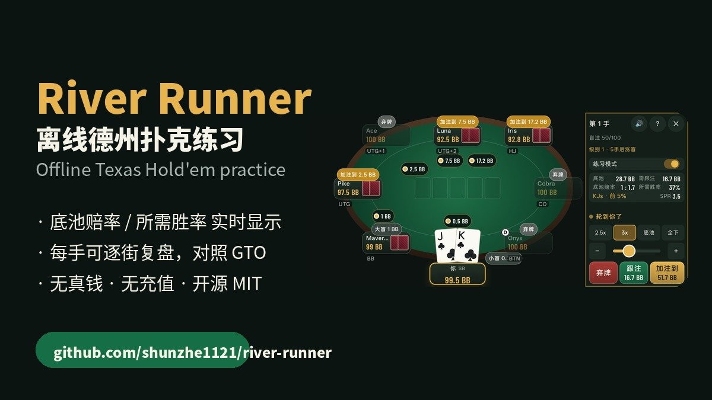
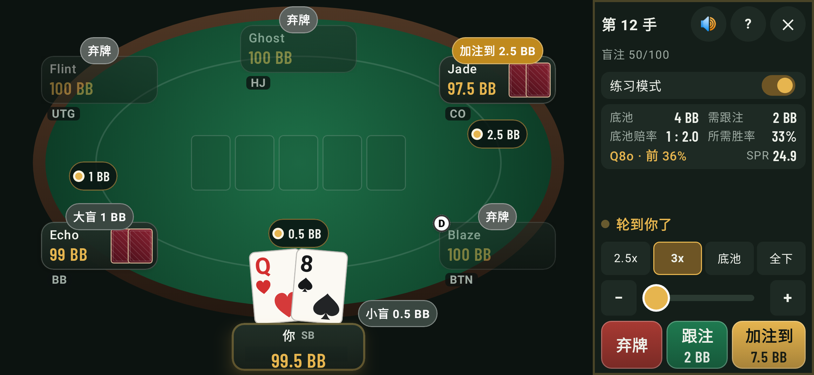
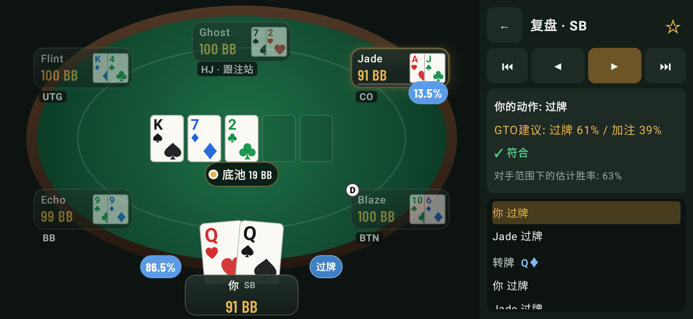
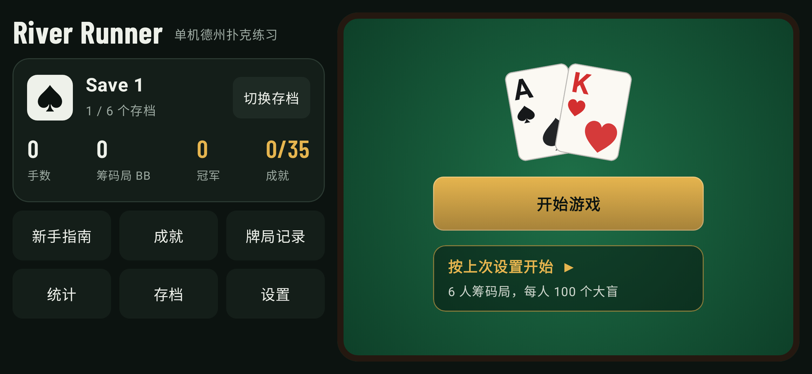
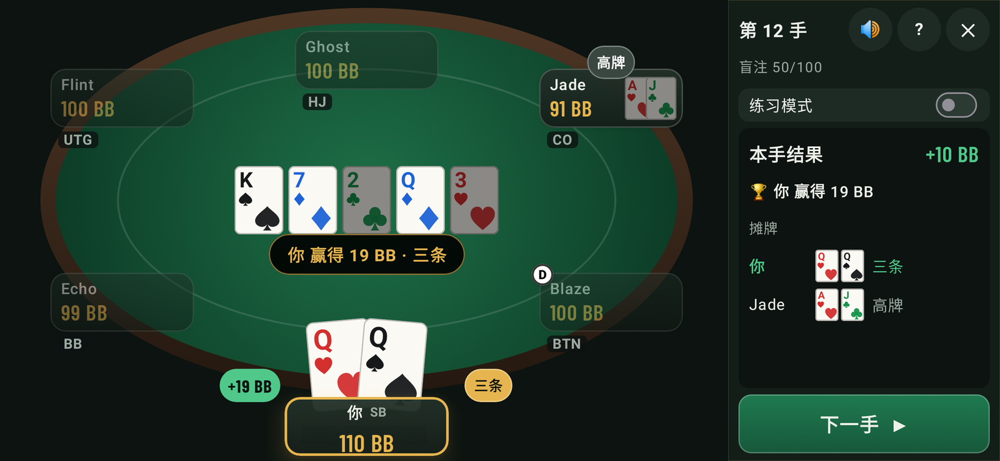
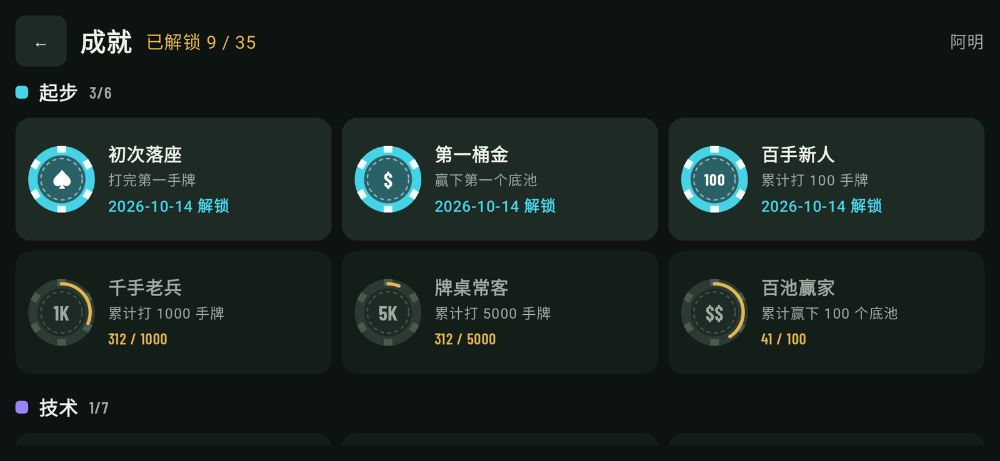

# River Runner ♠

<p align="center">
  
</p>

<p align="center">
  <b>An offline Texas Hold'em drill partner for Android.</b><br>
  <sub>No account · no ads · no in-app purchases · no network permission · 1.6 MB</sub>
</p>

<p align="center">
  <a href="https://github.com/shunzhe1121/river-runner/releases/tag/latest"></a>
  <br>
  <sub><a href="https://github.com/shunzhe1121/river-runner/releases/tag/latest">Direct APK link</a> · <a href="https://github.com/shunzhe1121/river-runner/releases">all releases</a> · Android 8.0+</sub>
</p>

<p align="center">
  
  
  
  
  
</p>

## What it is

Most poker trainers are subscriptions. Most free poker apps are online, ad-supported, or quietly steering you toward a deposit.

River Runner is neither. It is a study tool that runs entirely on your phone: you play hands against bots, and while you decide it shows the numbers a cash-game player actually uses — **pot odds, required equity, SPR** — without showing your own equity, because working that out is the exercise. After the hand you step back through it with **every hole card face up**, see what the GTO approximation would have done on each street, and whether you agreed with it.

No real money, no chips to buy, no login, nothing that phones home.

## 这是什么

市面上的德州训练软件要么按订阅收费，要么是带广告、引导充值的在线房间。

River Runner 两者都不是：一个完全跑在手机本地的练习工具。你和 NPC 对局，决策时它实时给出真实牌局里真正用得到的数字——**底池赔率、所需胜率、SPR**——但刻意不显示你自己的胜率，因为那部分正是要你自己算的。每手结束后可以逐街复盘，**所有底牌全部翻开**，每条街给出 GTO 建议并标记你的偏差。

没有真钱、没有充值、不用登录、不联网。

## Practice mode — the numbers, not the answer

<p align="center">
  
</p>

<p align="center"><sub>Jade opens to 2.5 BB, you are in the small blind with Q8o. Pot odds 1:2, required equity 33 %, SPR 24.9. Your own equity stays hidden — that is the part you are meant to work out.</sub></p>

## Replay — every card face up, with a verdict

<p align="center">
  
</p>

<p align="center"><sub>Board K♠7♦2♣, you hold Q♥Q♠ in the small blind. The solver approximation checks 61 % and raises 39 % here, and your check is marked ✓. Both sides' equity is put on the table for that street.</sub></p>

## A table that behaves like one

<p align="center">
  
  
  
</p>

<p align="center"><sub>Lobby with independent save slots · showdown with the winning hand spelled out · 35 achievement chips across six categories</sub></p>

## Features / 功能

| Area | What you get |
|---|---|
| **Tables / 牌桌** | Heads-up through 8-handed, landscape / 单挑到 8 人桌，横屏 |
| **Bots / NPC** | GTO table, or a mixed table of TAG / LAG / calling station / nit / maniac / GTO 桌或混合风格桌 |
| **Practice HUD / 练习面板** | Pot odds, required equity, SPR as you act — never your own equity / 实时底池赔率、所需胜率、SPR（不显示你的胜率） |
| **Replay / 复盘** | All hole cards, per-street equity, GTO suggestion with a deviation flag / 显示所有底牌、每条街胜率、GTO 建议与偏差标记 |
| **History / 记录** | Last 1000 hands kept automatically; star a hand to keep it forever / 自动保留最近 1000 手，收藏永久保存 |
| **Stats / 统计** | VPIP, PFR, 3-bet, WTSD, W$SD, BB/100, by position / 入池率、加注率、摊牌率、百手盈亏 |
| **Saves / 存档** | 6 slots, each with its own stats, history and achievements / 6 个独立存档 |
| **Achievements / 成就** | 35 chips across six categories / 6 类共 35 个成就 |
| **Language / 语言** | 中文 / English, switchable in-app |

<details>
<summary>Table feel, guide, tournaments and everything else / 牌桌手感、新手指南、锦标赛等</summary>

| Area | What you get |
|---|---|
| **Modes / 模式** | Cash (standings by chips) and single-table tournament with rising blinds and ICM payouts / 筹码局 + 单桌锦标赛 |
| **Stacks / 筹码** | Starting stack set in big blinds / 以大盲数设置起始筹码 |
| **Table feel / 牌桌体验** | Dealing and card-flip animations, chips sliding to the pot and to the winner, pulsing turn indicator, vibration on your turn, live action log; every hand waits for **Next hand** / 发牌翻牌动画、筹码动画、行动提示与震动、行动记录 |
| **Beginner guide / 新手指南** | Rules, hand rankings, positions, glossary, tips — also reachable from the table via **?** / 玩法、牌型、位置、术语、新手建议 |
| **Boss key / 静音** | Sound toggle on the table / 牌桌上可开关音效 |

</details>

## Before you install / 安装前请放心

An APK from a stranger's repository deserves suspicion. These are checkable, not promises:

- **No permissions at all.** [`AndroidManifest.xml`](app/src/main/AndroidManifest.xml) contains no `<uses-permission>` element — no `INTERNET`, no storage, no billing. It is 22 lines; read it.
- **1.6 MB.** No ad SDK, no analytics SDK, no crash reporter to inflate it.
- **Built by CI, not by hand.** Every push to `main` builds and publishes the `latest` release through GitHub Actions ([workflow](.github/workflows/build.yml)). The binary you download is the output of that job.
- **Signed with a public key.** The keystore in [`keystore/`](keystore/) is committed on purpose so each update installs over the previous one. Don't reuse that key for anything else.
- **sha256 is printed on the release**, next to the APK.

它没有任何权限声明、不含广告和统计 SDK、由 CI 从本仓库源码构建、签名密钥公开。想核实，看上面这 22 行 AndroidManifest 就够了。

<p align="center">
  
  <br><sub>Scan on Android to install · 手机扫码直接安装</sub>
</p>

## How the bots decide / NPC 如何决策

True GTO solutions only exist for heads-up play; no one can solve 5–8 handed games exactly. The bots use an approximation built from published solver output:

- **Preflop** — position-based raise-first-in, 3-bet, 4-bet and calling ranges (e.g. BTN ≈ 44 %, CO ≈ 28 %, UTG 6-max ≈ 17 % opens) on a 169-hand ordering that blends simulated equity with playability. Borderline hands are played as mixed strategies.
- **Short stacks** — Nash-style push/fold widths by stack depth and players left to act; calls against all-ins compare equity vs. the shover's range to pot odds — or to **ICM** required equity in tournaments.
- **Postflop** — Monte Carlo equity against each opponent's range (narrowed by their actions), board-texture-based bet sizing, value/bluff frequencies, pot odds with equity realisation, and minimum-defence guards.

Styles (TAG, LAG, station, nit, maniac) shift range widths, aggression, bluffing and call-down thresholds, so a mixed table has exploitable opponents.

真正的 GTO 只对单挑存在可靠解，多人局使用近似解：翻前按位置的范围表 + 混合策略；短筹码使用推/弃与 ICM；翻后根据对手范围的蒙特卡洛胜率、牌面结构、底池赔率做混合决策。

## Under the hood

- **`engine/`** — a plain Kotlin JVM module with no Android dependency: hand evaluator, NLHE state machine with side pots and all-ins, ICM, Monte Carlo equity, bot ranges, hand records and replay, stats. `./gradlew :engine:test` runs it all on a laptop.
- **`app/`** — Jetpack Compose, landscape, one hand-written design system (see [DESIGN.md](DESIGN.md)).
- **The screenshots above are generated, not taken.** Robolectric + Roborazzi render them on the JVM in CI (`./gradlew :app:recordRoborazziDebug`) and publish to the [`screenshots`](https://github.com/shunzhe1121/river-runner/tree/screenshots) branch — deterministic, no emulator, no device. The copies in `docs/shots/` are pulled from that branch.

## Build / 构建

```bash
./gradlew :engine:test          # rules, side pots, ICM, replay
./gradlew :app:assembleRelease  # APK in app/build/outputs/apk/release/
```

Barlow Condensed is bundled under the SIL Open Font License (`licenses/`).

## If this is useful to you

There is no subscription, no ad and no telemetry in River Runner — the only budget it runs on is attention, and on GitHub stars are the signal that decides whether the next person searching for an offline poker trainer ever finds it.

- **⭐ Star the repo** if you want more people to find a free trainer. It costs one click and it is the whole marketing department.
- **🐞 Open an issue** if something is wrong or missing. Reports get read and fixed; that is also how you tell whether a project is alive.
- **🍴 Fork it** if you are building something similar. The engine is MIT — take it, the maths is the hard part.

如果它对你有点用，一个 star 就是最便宜的支持方式。项目没有订阅、没有广告、也没有埋点。

## License

MIT
